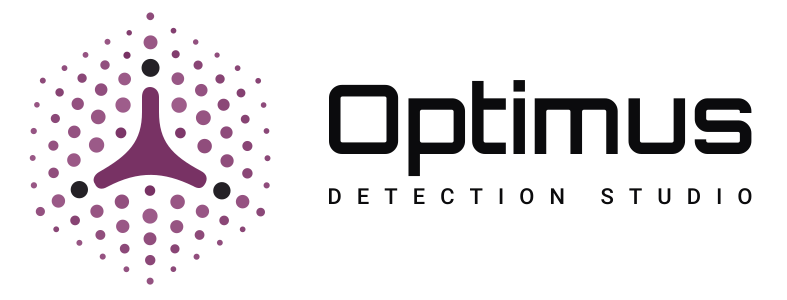
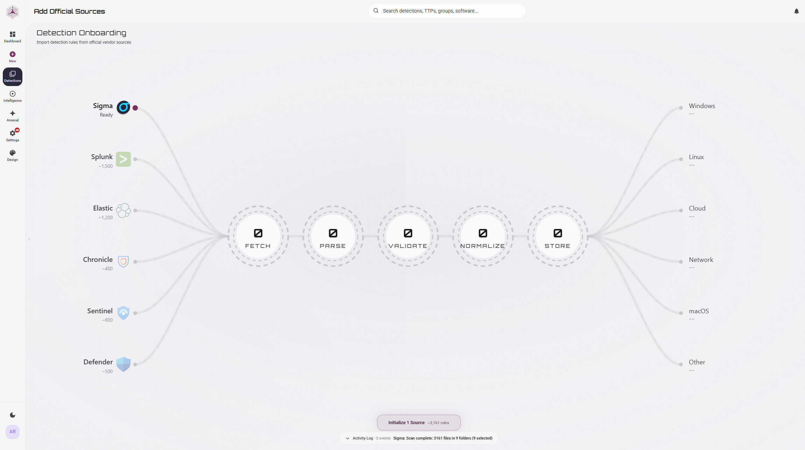
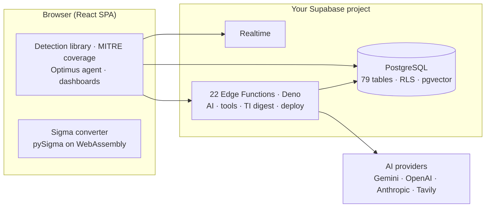

<div align="center">

<picture>
  <source media="(prefers-color-scheme: dark)" srcset="public/brand/point-field/lockup-dark.svg" />
  
</picture>

<h3>The detection intelligence platform</h3>

One system of record for every detection you run, across every SIEM and XDR, with live MITRE ATT&CK coverage and an AI layer that knows your library.

[](LICENSE)

[Quickstart](#quickstart) &nbsp;·&nbsp; [Features](#what-it-does) &nbsp;·&nbsp; [Integrations](#integrations) &nbsp;·&nbsp; [Setup](#setup) &nbsp;·&nbsp; [Architecture](#architecture) &nbsp;·&nbsp; [Roadmap](#roadmap) &nbsp;·&nbsp; [Contributing](#contributing)

<br/>


</div>

---

## Why Optimus

Detection content is no longer the bottleneck. SigmaHQ, Splunk ESCU, Elastic, and the wider community publish **thousands of tested detection rules**, and more arrive every day. What teams lack is everything a rule needs *after* the download.

- **A query is not a detection.** A complete detection carries documentation (what it catches, how to investigate and respond, known false positives, test cases) and a lifecycle: drafted, reviewed, tested, tuned, deployed, retired. A bare query in a console is tribal knowledge with a trigger condition.
- **There is no single source of truth.** Detections live where they run: the SIEM, the data lake, the EDR, the XDR console, each with its own language and rule format. The usual "central view" is a spreadsheet or a ticket board, out of date the day it is created.
- **So coverage is unknowable.** Which ATT&CK techniques are detected in production today? How ready is the team for Scattered Spider, or for the campaign in this morning's advisory? Which rules are tuned, drifting, or retired but still firing? Each answer becomes a multi-week audit.

Optimus closes that gap. It is a system of record for every detection you own, on every platform you run, with an intelligence layer that tells you what it all adds up to. It is built for SOC and detection engineering teams, and for the MSSPs who run them.

## What it does

| Stage | What Optimus does |
|---|---|
| **Unify your estate** | Bulk-import vendor content (SigmaHQ, Splunk ESCU, Elastic, Chronicle, Microsoft Sentinel, CrowdStrike, SentinelOne) and pull the rules already deployed in your SIEM/XDR. Everything is parsed, normalized, and deduplicated into one library spanning 17 query languages. |
| **Map coverage to ATT&CK** | The full MITRE ATT&CK knowledge graph of techniques, groups, software, campaigns, mitigations, and data sources. Filter live coverage by threat actor, campaign, software, or origin country; your environment profile surfaces the groups targeting your sector. Navigator layers import and export. |
| **Ask instead of audit** | Ask about coverage against ransomware, readiness for a specific actor, or where the gaps are, and get answers grounded in *your* library through hybrid semantic and keyword search. |
| **Document with AI** | AI autofill drafts the description, MITRE mapping, severity, data sources, false-positive guidance, and linked threat actors. A second action drafts investigation steps and response actions, and test cases can be pulled from Atomic Red Team. |
| **Engineer and translate** | Generate queries in SPL, KQL, EQL, Sigma, and more; validate and explain existing logic with AI; convert rules between platforms with in-browser Sigma conversion to 16 targets. |
| **Triage new threats** | The opt-in daily auto-digest ranks new threat reports by relevance to your environment, extracts TTPs, IoCs, and any detection logic they contain, and checks the techniques against your existing coverage. |
| **Research threats autonomously** | Give it a CVE, actor, campaign, or technique. A multi-agent pipeline runs cited research, maps behaviours to ATT&CK, checks what your library already covers, and drafts detections in your SIEM's query language, with automated MITRE, syntax, and citation checks. |
| **Run the lifecycle** | Eight lifecycle states from backlog to archive on a drag-and-drop board, with peer review, threaded comments, assignments, publishing approvals, and five-tier RBAC. |
| **Deploy and stay in sync** | Guided deployment to six SIEM/XDR platforms (Splunk, Sentinel, Elastic, Chronicle, CrowdStrike, Defender XDR), with drift detection on each connection after sync. |

## Screenshots

**MITRE ATT&CK coverage:** live detection coverage showing what you catch, what you miss, and where to invest next.


**Onboarding:** import thousands of rules from vendor sources through a `fetch → parse → validate → normalize → store` pipeline.



## Integrations

**Available now.** Native SIEM/XDR integrations: connect and test, deploy detections, import the rules already deployed, and detect drift between your library and each connection. Supported rule types for import vary by platform. Rules can be updated in place on CrowdStrike, Sentinel, and Defender XDR, and enabled, disabled, or deleted on CrowdStrike.

| | | |
|---|---|---|
| **Splunk** (Enterprise & Cloud) | **Microsoft Sentinel** | **Microsoft Defender XDR** |
| **Elastic Security** | **Google SecOps** (Chronicle) | **CrowdStrike Falcon** (NG-SIEM / LogScale) |

**Conversion supported, native integration planned.** The in-browser Sigma converter already produces rules for these platforms; direct API integrations are on the roadmap:

> IBM QRadar · OpenSearch · SentinelOne · Palo Alto Cortex XDR · VMware Carbon Black · Datadog · Grafana Loki

**Planned.** GitHub, GitLab, and Azure DevOps for detection-as-code; Jira and Slack for workflow automation.

## Quickstart

Optimus runs against your own Supabase project and your own AI provider keys. It has no dependency on a hosted instance.

```bash
git clone https://github.com/arpanraval/optimus-detection-studio.git
cd optimus-detection-studio
bun install
cp .env.example .env.local     # add your Supabase URL + anon key
bun run setup                  # guided end-to-end install: schema, functions, secrets, automation
bun run dev
```

`bun run setup` is a guided installer. It links your project and applies the full database from [`supabase/schema.sql`](supabase/schema.sql), a single self-contained schema (79 tables plus functions, RLS, triggers, realtime, and seed data) that CI verifies against an empty database. It then deploys all 22 edge functions, prompts for your AI keys, configures Threat Research background automation, verifies the install, and prints a per-step summary. Re-runs preserve the existing schema and Edge Function secrets, repeat compatibility repairs, and redeploy functions. Required tables and functions are checked by name. See [SETUP.md](SETUP.md) for retry behavior and supported API-key formats. The full walkthrough (secrets, first owner, MITRE import) is in [Setup](#setup).

> **Prerequisites:** [Bun](https://bun.sh), the [Supabase CLI](https://supabase.com/docs/guides/cli), `psql`, a Supabase project (the free tier works), and a Gemini API key for the full AI experience.

---

## Architecture

Optimus is a React single-page app backed by your own Supabase project. All AI keys and privileged logic live server-side in edge functions; the browser never holds a provider key.



<details>
<summary><b>AI agent flow &amp; semantic search</b></summary>

```
User query → ai-generate edge function (system prompt + tools)
           → LLM may invoke tools → optimus-tools executes against the DB
           → results synthesised → structured response rendered (≤5 tool iterations)

Detection saved → generate-embedding → Gemini embedding (1536-dim)
               → stored in detection_embeddings (pgvector)
               → hybrid search (semantic + keyword) powers the agent's search_library tool
```
</details>

<details>
<summary><b>Project structure</b></summary>

```
├── src/
│   ├── components/          # React UI (detection, library, mitre, optimus, dashboard, ui, rbac, …)
│   ├── context/ · hooks/ · router/
│   ├── lib/                 # ai/ (agent tools, prompts), aiService, supabaseClient, …
│   ├── services/            # sigma/ (browser conversion), bulk-import/
│   ├── types/ · constants.ts · mitre.ts
├── supabase/
│   ├── schema.sql               # ← full database schema (single source of truth)
│   ├── config.toml              # project config (link / functions / db)
│   ├── optional-scheduled-jobs.sql
│   ├── functions/               # Edge Functions (22)
│   └── migrations/              # historical chain plus forward migrations
├── scripts/                 # setup.ts (`bun run setup`) · setup-check.ts (`bun run setup:check`)
└── .github/workflows/       # CI: schema-check applies schema.sql on empty Postgres
```
</details>

## Tech stack

| Layer | Technologies |
|---|---|
| **Frontend** | React 19 · TypeScript · Vite · Tailwind CSS · Monaco · custom SVG charts |
| **Backend** | Supabase: PostgreSQL · pgvector · Realtime · Edge Functions (Deno) |
| **AI** | Gemini (default) · OpenAI · Anthropic · Tavily (web search), all server-side |
| **Sigma conversion** | pySigma on Pyodide, running fully in the browser (no server-side Python) |
| **Tooling** | Bun · Vitest · ESLint · GitHub Actions CI |

---

## Setup

> New to the stack? [SETUP.md](SETUP.md) is the full from-scratch walkthrough, covering prerequisites with install commands, `supabase login`, the database connection string, and troubleshooting.

### 1. Clone and install

```bash
git clone https://github.com/arpanraval/optimus-detection-studio.git
cd optimus-detection-studio
bun install
```

### 2. Configure your environment

```bash
cp .env.example .env.local
```

Set your project URL and anon key (Supabase Dashboard → Settings → API):

```env
VITE_SUPABASE_URL=https://YOUR_REF.supabase.co
VITE_SUPABASE_ANON_KEY=your-anon-key
```

### 3. Run setup

```bash
bun run setup
```

The installer links your project, applies `supabase/schema.sql`, deploys all 22 edge functions, prompts for your AI keys (generating the encryption key for you), configures Threat Research background automation (Vault and pg_cron), runs the install check, and prints a per-step summary of what completed, was skipped, or failed. It is safe to re-run at any time. To run the core steps by hand instead (use `npx supabase` if the CLI is not on your path):

```bash
supabase link --project-ref YOUR_REF
psql "YOUR_DB_CONNECTION_STRING" -v ON_ERROR_STOP=1 -f supabase/schema.sql
supabase functions deploy
```

### 4. Set edge-function secrets

The core experience needs a Gemini key and an encryption key:

```bash
ENCRYPTION_KEY="$(bun -e 'console.log(require("node:crypto").randomBytes(32).toString("hex"))')"

supabase secrets set \
  GEMINI_API_KEY=... \
  INTEGRATION_ENCRYPTION_KEY="$ENCRYPTION_KEY"
```

If the app is served from anywhere other than `localhost`, also set `ALLOWED_ORIGINS` to your app's origin, or the edge functions will reject its requests (CORS).

<details>
<summary><b>All edge-function secrets</b></summary>

| Secret | Required | Purpose |
|---|---|---|
| `GEMINI_API_KEY` | yes | Gemini generation plus embeddings / semantic search |
| `ANTHROPIC_API_KEY` | yes, for Threat Research + Detection Finetuning | powers the Threat Research agents and the managed finetuning agents; also usable as a generation provider |
| `INTEGRATION_ENCRYPTION_KEY` | yes (for SIEM integrations) | AES-GCM key for stored credentials; `bun run setup` generates it. Do not rotate it once integrations are stored. |
| `ALLOWED_ORIGINS` | yes, for any non-localhost deployment | comma-separated CORS allowlist; without it only `localhost:5173`, `localhost:3000`, and `127.0.0.1:5173` are allowed |
| `SITE_URL` | optional | base URL used in invitation emails |
| `OPENAI_API_KEY` | optional | alternate generation provider |
| `TAVILY_API_KEY` | optional | web search for the Optimus Prime agent and Threat Research |
| `GITHUB_TOKEN` | optional | lets Threat Research search public vendor rule repositories |
| `NATIVE_SIEM_MUTATIONS` | optional | set to `true` to allow in-place updates and enable/disable of rules already in your SIEM |
| `FINETUNE_AGENT_ID` / `FINETUNE_ENVIRONMENT_ID` | optional | managed-agent detection finetuning for Defender XDR or Sentinel (needs `ANTHROPIC_API_KEY` on the same account); provision once with `ANTHROPIC_API_KEY=... bun scripts/setup-finetune-agent.ts`. See [SETUP.md](SETUP.md). |
| `CROWDSTRIKE_FINETUNE_AGENT_ID` / `CROWDSTRIKE_FINETUNE_ENVIRONMENT_ID` | optional | CrowdStrike detection finetuning; provision with `bun scripts/setup-crowdstrike-finetune-agent.ts` |
| `RESEND_API_KEY` / `DEMO_NOTIFY_EMAIL` | optional | demo-request notification emails |

Supabase injects `SUPABASE_URL`, `SUPABASE_ANON_KEY`, and `SUPABASE_SERVICE_ROLE_KEY` into edge functions automatically. Do not set them yourself; the CLI rejects any secret name starting with `SUPABASE_`.
</details>

### 5. Create the owner account and load MITRE data

1. **Turn off public sign-ups** in the Supabase dashboard: **Authentication → Sign In / Providers → Allow new users to sign up** (off). Access is invite-only: there is no in-app sign-up form, and teammates are added from **Settings → Users**, which still works with sign-ups disabled.
2. Issue the first owner's invitation in the Supabase SQL editor. Every account needs an invitation, including ones added in the dashboard, and the invitation sets the role:
   ```sql
   select public.bootstrap_first_owner('you@example.com');
   ```
3. Create that user: **Authentication → Users → Add user → Create new user** with the same email (tick *Auto Confirm User*). The `on_auth_user_created` trigger creates your profile as owner.
   Then start the app (`bun run dev`), sign in with that user, and follow the first-login prompt to confirm your display name and set a **new** password (it must differ from the one you just created). You'll land in the vendor-rule import wizard; use it or **Skip for now**.
4. In-app: **Settings → Data Sync → "Import MITRE Data"**, then **"Refresh Scores"**. This pulls the full ATT&CK STIX bundle (techniques, groups, software, campaigns, mitigations, data sources, and their relationships) from MITRE's public GitHub into your database. A lightweight tactic/technique reference (`public/enterprise-attack-data.json`) ships in the repo for the coverage UI, reproduced under MITRE's terms; see [NOTICE](NOTICE).

### 6. Run and verify

```bash
bun run dev          # dev server            bun run test         # tests (vitest)
bun run build        # production build       bun run type-check   # TypeScript
bun run setup:check  # verify your install is healthy (env, schema, functions, secrets, automation)
```

> **Threat Research needs background automation** (Supabase Vault secrets plus pg_cron/pg_net). `bun run setup` configures it when you provide your service-role key. If that step was skipped, research sessions stay *pending*; re-run `bun run setup` or apply [`supabase/optional-scheduled-jobs.sql`](supabase/optional-scheduled-jobs.sql) by hand. The scheduled auto-digest and AI-usage rollups are optional. See [SETUP.md](SETUP.md) step 6a.

---

## Capabilities in depth

<details>
<summary><b>AI &amp; intelligence layer</b>: Optimus Prime agent, query generator, autofill, validation, finetuning</summary>

**Optimus Prime agent:** a RAG assistant that searches your library, analyzes coverage, assesses readiness against specific threat actors (APT29, Scattered Spider, Lazarus, Volt Typhoon…), queries the MITRE knowledge base, generates Navigator layers, and searches the web. Eight tools: `search_library`, `get_coverage_summary`, `find_threat_actor`, `get_threat_actor_coverage`, `identify_coverage_gaps`, `query_mitre`, `generate_navigator_layer`, `web_search`. Gap analysis covers predefined threat profiles (Ransomware, APT, Initial Access, Persistence, Credential Access, Defense Evasion, Lateral Movement, Exfiltration, Impact) plus custom technique sets. Multi-model (Gemini default, OpenAI, Anthropic); sessions are stored locally in the browser.

**AI query generator:** natural language to queries in Splunk SPL, Sentinel KQL, Defender XDR KQL, Elastic EQL, Sigma, YARA, Chronicle YARA-L, CrowdStrike LogScale, and SentinelOne (S1QL / PowerQuery). Refine iteratively in conversation, including switching the target language ("now in KQL").

**Autofill:** infers description, MITRE techniques, severity, data sources, tags, false-positive guidance, and linked groups, software, and campaigns from the query. A separate action drafts investigation steps, response actions, and blind spots; test cases can be matched from Atomic Red Team.

**Validate & Explain:** identifies the query language, checks syntax, and explains the logic in plain English.

**Detection finetuning:** a managed agent that tunes a detection's query by running test queries against live data in Defender XDR, Sentinel, or CrowdStrike.

**Playbooks:** ransomware-readiness and threat-actor coverage reports generated from your library.
</details>

<details>
<summary><b>Detection library &amp; data model</b>: lifecycle, multi-query, rich metadata</summary>

Two libraries: **Development** (drafts, imported content, work in progress) and **Production** (approved, published detections), with a publishing approval step between them. Each detection carries lifecycle status (`Backlog → Draft → Development → Review → Testing → Production → Deprecated → Archived`), severity/confidence, quality score, multi-language queries, MITRE technique/tactic mapping, linked Groups/Software/Campaigns/CVEs, log sources and platforms, investigation steps, response actions, false-positive guidance, test cases, and publishing lineage. Monaco editor, advanced filtering, server-side pagination for large libraries, bulk actions (including AI MITRE mapping across a selection), upstream-update tracking for imported vendor rules, and detection packs.
</details>

<details>
<summary><b>Supported query languages (17)</b></summary>

SPL (Splunk) · KQL (Sentinel / Defender) · Kuery (Elastic) · EQL (Elastic) · ES\|QL (Elastic) · Elasticsearch DSL · Lucene · Sigma · CQL (CrowdStrike LogScale) · S1QL and S1QL 2.0 (SentinelOne) · PowerQuery (SentinelOne) · YARA-L (Chronicle) · YARA · SQL · Carbon Black · Datadog.
</details>

<details>
<summary><b>Sigma converter</b>: 16 target platforms</summary>

**SIEM:** Splunk, Elasticsearch (Lucene / ES\|QL / EQL), OpenSearch, IBM QRadar, Grafana Loki.
**EDR:** CrowdStrike LogScale, VMware Carbon Black, SentinelOne, Palo Alto Cortex XDR.
**Cloud:** Microsoft Sentinel, Microsoft Defender XDR, Google Chronicle (SecOps), Datadog.

Runs entirely in-browser via pySigma on Pyodide (WebAssembly), with custom pipeline support. Paste a single rule or several YAML documents at once.
</details>

<details>
<summary><b>MITRE ATT&amp;CK integration</b>: matrix, coverage, threat context</summary>

Interactive heatmap (coverage density per technique, sub-technique expansion, platform filtering); one-click coverage filtering by threat group, campaign, software, and origin country; coverage analytics by tactic, platform, and production-only; entity linking across the imported ATT&CK relationship graph (Groups, Software, Campaigns, Mitigations, data sources) with browse pages for each; defensive-posture assessment; Navigator layer import and export, plus heatmap image and Excel export.
</details>

<details>
<summary><b>Threat intelligence, autonomous research &amp; bulk import</b></summary>

**Threat-intel digest (v2):** a multi-stage AI pipeline that produces a summary, attack-type classification, MITRE TTP extraction (with evidence quotes), and IoC and detection-rule extraction (30+ IoC categories, defang reversal, false-positive flagging), all mapped against your existing coverage. Run it on demand, or enable the auto-digest to process your threat-intel feeds once a day at a time you choose.

**Autonomous threat research:** give it a topic (a CVE, an actor, a campaign, a technique) and a multi-agent pipeline runs end to end: cited web research, ATT&CK behaviour mapping, a check against what your library already covers, then one drafted detection per opportunity in your SIEM's query language. Drafts pass deterministic MITRE, Sigma-syntax, and citation checks, and every step is recorded in a full transcript.

**Bulk import:** SigmaHQ (YAML), Splunk ESCU (YAML), Elastic (TOML), Chronicle (YARA-L), Microsoft Sentinel (YAML), CrowdStrike (CQL), and SentinelOne from ZIP files, uploads, or GitHub repos → detect format → parse → normalize → validate → deduplicate (by source rule ID) → persist → audit. A pre-check shows what is new, updated upstream, or unchanged; skip/update/create-new strategies and per-import rollback are included.
</details>

<details>
<summary><b>Collaboration, RBAC &amp; reporting</b></summary>

**Workflows:** peer review (authors can't review their own; Lead and above only), threaded comments, assignments, and a Development→Production publishing approval queue. Review decisions and comments are audit-logged.

**RBAC:** five roles (Owner, Admin, Lead, Analyst, Viewer), each with a fixed permission set covering detection management, review and workflow, library access, AI and tools, MITRE and threat intel, integrations, and settings.

**Reporting:** dashboard KPIs, pipeline and distribution charts, coverage trends, and PDF / Excel / JSON / Navigator-layer export.
</details>

---

## Roadmap

**Shipped:** detection library (17 query languages) · MITRE matrix and coverage analytics · Optimus Prime agent · AI query generation, autofill, and validation · threat-intel digest and scheduled auto-digest · autonomous threat research · detection finetuning · playbooks · bulk import · browser-based Sigma conversion · peer review, comments, and assignments · five-tier RBAC · publishing workflow · vector search · dashboards and exports · Navigator layers · threat-actor enrichment · detection packs with a guided deploy wizard for six SIEM/XDR providers · per-connection drift detection · realtime notifications · environment profile · SIEM/XDR home.

**In progress:** library UX and data-quality refinements.

**Planned:** detection-as-code (git-backed workflows) · SSO (SAML/OIDC) and SCIM · detection pattern learning and improvement engine · cross-SIEM drift view and sync · public REST API and webhooks · observability · multi-tenancy (MSSP mode).

---

## Contributing

Contributions are welcome. See [CONTRIBUTING.md](CONTRIBUTING.md) and the [Code of Conduct](CODE_OF_CONDUCT.md). Before opening a pull request, run `bun run lint`, `bun run type-check`, `bun run test`, and `bun run build`.

## Security

Please report vulnerabilities privately as described in [SECURITY.md](SECURITY.md). Do not open a public issue for security problems.

## License

Licensed under the [GNU Affero General Public License v3.0](LICENSE) (AGPL-3.0-only). This project bundles and builds on third-party content that requires attribution, including **MITRE ATT&CK®** and **SigmaHQ / pySigma**. See [NOTICE](NOTICE).

---

<div align="center">

<picture>
  <source media="(prefers-color-scheme: dark)" srcset="public/brand/point-field/mark-dark.svg" />
  
</picture>

<sub>Built on <a href="https://supabase.com">Supabase</a>, <a href="https://github.com/SigmaHQ/pySigma">pySigma</a>, and the <a href="https://attack.mitre.org">MITRE ATT&CK®</a> knowledge base.</sub>

</div>
