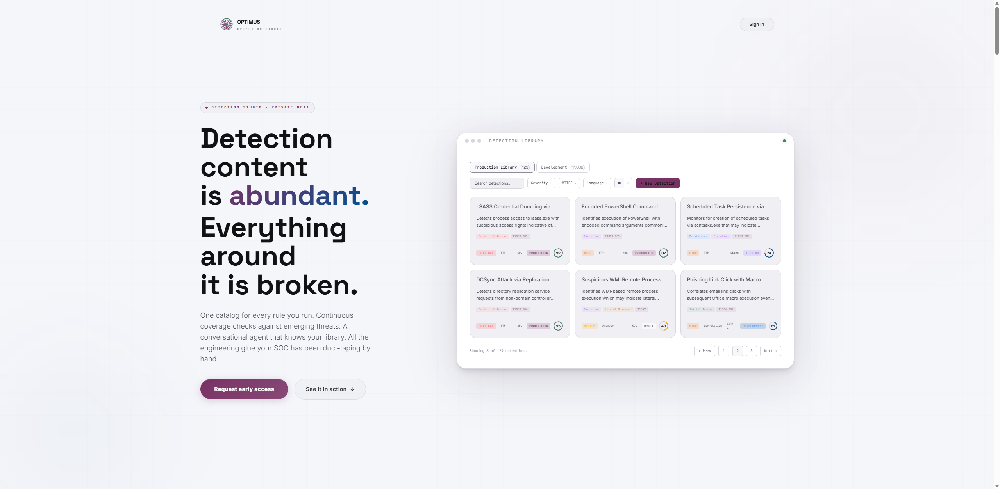
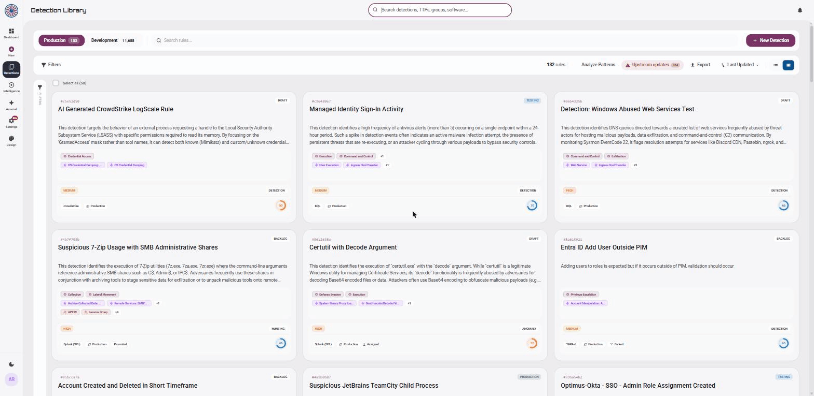
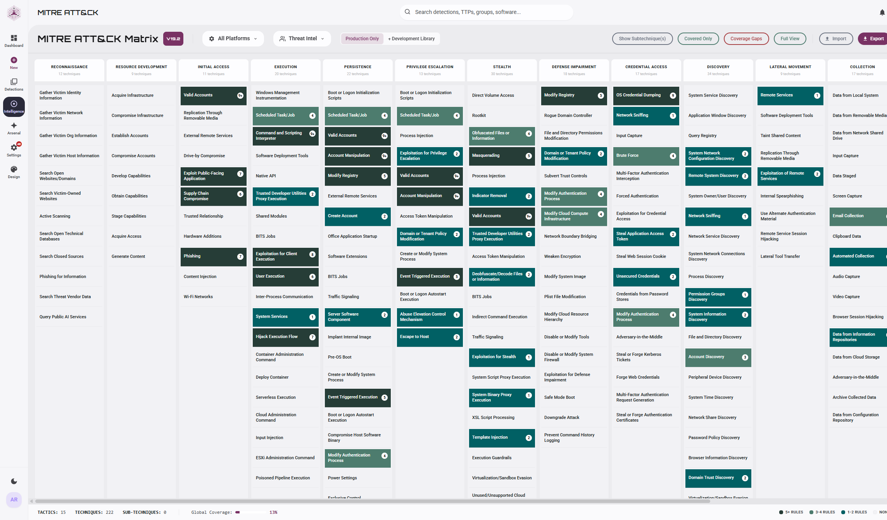
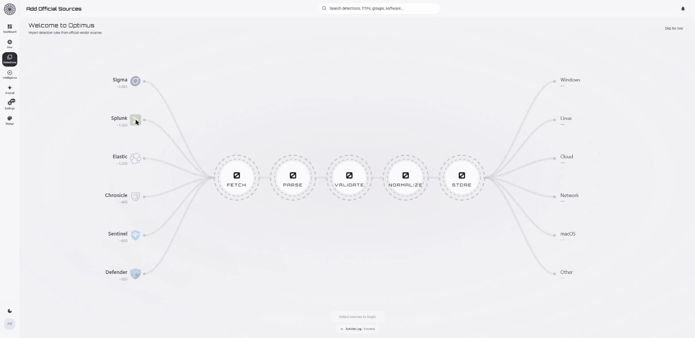

<div align="center">


# Optimus Detection Studio

**The open-source command center for detection engineering & detection intelligence.**

Turn a scattered pile of detection rules into **measured, deployed, threat-informed coverage** — with an AI agent that knows your library, MITRE ATT&CK as the map, and a guided deploy pipeline to your SIEM.

[](LICENSE)
[](#tech-stack)
[](#architecture)
[](#setup)
[](CONTRIBUTING.md)

[**Quickstart**](#quickstart) &nbsp;•&nbsp; [**Features**](#features) &nbsp;•&nbsp; [**Setup**](#setup) &nbsp;•&nbsp; [**Architecture**](#architecture) &nbsp;•&nbsp; [**Roadmap**](#roadmap) &nbsp;•&nbsp; [**Contributing**](#contributing)

<br/>



</div>

---

## Why Optimus

Every SOC has access to 10,000+ detection rules — and still can't answer the questions that actually matter:

- **Are we covered?** Which MITRE ATT&CK techniques do our detections actually catch, and where are the holes?
- **Are we ready for _this_ threat?** How well do we detect Scattered Spider — or ransomware — *right now?*
- **Does it even work?** Is this rule tuned, tested, and live in the SIEM — or rotting in a backlog?

The rules are abundant. The engineering *around* them — choosing, building, proving, deploying, and measuring — is manual, scattered across spreadsheets and SIEM consoles, and painfully slow.

**Optimus is that missing layer.** One place to build detections, measure coverage against ATT&CK, ask an AI agent that actually knows your library, and ship to your SIEM. Built for SOC and detection-engineering teams — and the MSSPs who run them.

## Features

| Capability | What you get |
|---|---|
| **AI detection engineering** | A RAG agent that knows *your* library — hybrid semantic + keyword search, coverage-gap analysis, threat-actor readiness, natural-language → query generation, autofill, and logic validation. |
| **MITRE ATT&CK intelligence** | Interactive coverage matrix (Enterprise v18.1), tactic and platform breakdowns, gap analysis against threat profiles, and Navigator layer export. |
| **Detection library** | Two-tier (personal + universal) with rich metadata, a full lifecycle pipeline, multi-language queries, and curated packs. |
| **In-browser Sigma conversion** | pySigma on WebAssembly to 12+ SIEM/EDR targets, with zero server-side Python. |
| **Bulk vendor import** | SigmaHQ, Splunk ESCU, Elastic, and Chronicle — parse, normalize, deduplicate, validate, roll back. |
| **Threat-intel digest** | An AI pipeline that turns reports (URL or pasted) into TTPs, IoCs, and detection rules mapped against your coverage. |
| **SIEM / XDR deployment** | Push detections to six platforms (Splunk, Sentinel, Elastic, Chronicle, CrowdStrike, Defender XDR) with drift tracking. |
| **Collaboration & RBAC** | Peer review, threaded comments, assignments, a publishing approval queue, and a five-tier role system. |

## Screenshots

<table>
<tr>
<td width="50%" valign="top">

**Detection library** — one searchable catalog for every rule, across languages, SIEMs, and lifecycle stages.

</td>
<td width="50%" valign="top">

**MITRE ATT&CK coverage** — a live heatmap of exactly what you can and can't detect.

</td>
</tr>
<tr>
<td></td>
<td></td>
</tr>
</table>

**Onboarding** — import thousands of rules from official vendor sources through a `fetch → parse → validate → normalize → store` pipeline.



## Quickstart

Optimus is **self-hostable** — it runs against **your own** Supabase project and **your own** AI keys. Nothing depends on any hosted instance.

```bash
git clone https://github.com/arpanraval/optimus-detection-studio.git
cd optimus-detection-studio
bun install
cp .env.example .env.local     # add your Supabase URL + anon key
bun run setup                  # links project, applies schema.sql, deploys 19 edge functions
bun run dev
```

`bun run setup` applies the **entire database** in one shot — [`supabase/schema.sql`](supabase/schema.sql) is a single, self-contained schema (62 tables, functions, RLS, triggers, realtime, seed data), CI-verified to apply on an empty database. The full walkthrough (secrets, first owner, MITRE import) is in **[Setup](#setup)**.

> **Prerequisites** — [Bun](https://bun.sh) • [Supabase CLI](https://supabase.com/docs/guides/cli) • `psql` • a Supabase project (free tier is fine) • at least one AI key (Gemini / OpenAI / Anthropic).

---

## Architecture

Optimus is a React single-page app talking to **your own** Supabase project. All AI keys and privileged logic live server-side in edge functions — the browser never holds a provider key.


<details>
<summary><b>AI agent flow &amp; semantic search</b></summary>

```
User query → ai-generate edge function (system prompt + tools)
           → LLM may invoke tools → optimus-tools executes against the DB
           → results synthesised → structured response rendered (≤5 tool iterations)

Detection saved → generate-embedding → Gemini embedding (1536-dim)
               → stored in detection_embeddings (pgvector)
               → hybrid search (semantic + keyword) powers the agent's search_library tool
```
</details>

<details>
<summary><b>Project structure</b></summary>

```
├── src/
│   ├── components/          # React UI (detection, library, mitre, optimus, dashboard, ui, rbac, …)
│   ├── context/ · hooks/ · router/
│   ├── lib/                 # ai/ (agent tools, prompts), aiService, supabaseClient, …
│   ├── services/            # sigma/ (browser conversion), bulk-import/
│   ├── types.ts · constants.ts · mitre.ts
├── supabase/
│   ├── schema.sql               # ← full database schema (single source of truth)
│   ├── config.toml              # project config (link / functions / db)
│   ├── optional-scheduled-jobs.sql
│   ├── functions/               # Edge Functions (19)
│   └── migrations/              # historical migration chain (reference only)
├── scripts/                 # setup.ts (`bun run setup`) · setup-check.ts (`bun run setup:check`)
└── .github/workflows/       # CI — schema-check applies schema.sql on empty Postgres
```
</details>

## Tech stack

| Layer | Technologies |
|---|---|
| **Frontend** | React 19 · TypeScript · Vite · Tailwind CSS · Monaco · Recharts |
| **Backend** | Supabase — PostgreSQL · pgvector · Realtime · Edge Functions (Deno) |
| **AI** | Gemini (default) · OpenAI · Anthropic · Tavily (web search) — all server-side |
| **Sigma conversion** | pySigma on Pyodide — runs fully in the browser (no server-side Python) |
| **Tooling** | Bun · Vitest · ESLint · GitHub Actions CI |

---

## Setup

### 1. Clone and install

```bash
git clone https://github.com/arpanraval/optimus-detection-studio.git
cd optimus-detection-studio
bun install
```

### 2. Configure your environment

```bash
cp .env.example .env.local
```

Set your project URL and anon key (Supabase Dashboard → Settings → API):

```env
VITE_SUPABASE_URL=https://YOUR_REF.supabase.co
VITE_SUPABASE_ANON_KEY=your-anon-key
VITE_APP_ENV=development
```

### 3. Run setup

```bash
bun run setup
```

This links your project, applies `supabase/schema.sql`, deploys all **19 edge functions**, and prints the exact secrets command. Prefer to do it by hand?

```bash
supabase link --project-ref YOUR_REF
psql "YOUR_DB_CONNECTION_STRING" -v ON_ERROR_STOP=1 -f supabase/schema.sql
supabase functions deploy
```

### 4. Set edge-function secrets

At minimum, one AI key plus the service role and an encryption key:

```bash
supabase secrets set \
  GEMINI_API_KEY=... \
  SUPABASE_SERVICE_ROLE_KEY=... \
  INTEGRATION_ENCRYPTION_KEY=$(openssl rand -hex 32)
```

<details>
<summary><b>All edge-function secrets</b></summary>

| Secret | Required | Purpose |
|---|---|---|
| `GEMINI_API_KEY` / `OPENAI_API_KEY` / `ANTHROPIC_API_KEY` | at least one | AI providers (Gemini is primary) |
| `SUPABASE_SERVICE_ROLE_KEY` | yes | privileged DB access for functions |
| `INTEGRATION_ENCRYPTION_KEY` | yes (for SIEM integrations) | AES-GCM key for stored credentials — `openssl rand -hex 32` |
| `TAVILY_API_KEY` | optional | threat-intel web search |
| `RESEND_API_KEY` / `DEMO_NOTIFY_EMAIL` | optional | demo-request notification emails |
| `ALLOWED_ORIGINS` / `SITE_URL` | optional | CORS allowlist + email links |

`SUPABASE_URL` and `SUPABASE_ANON_KEY` are auto-injected into edge functions.
</details>

### 5. Become owner and load MITRE data

1. Start the app and **sign up** — the `on_auth_user_created` trigger creates your profile.
2. Promote yourself in the Supabase SQL editor:
   ```sql
   update public.profiles set role = 'owner' where email = 'you@example.com';
   ```
3. In-app: **Settings → MITRE Data Sync → "Import MITRE Data"**, then **"Refresh Scores"**. This pulls the ATT&CK STIX bundle from MITRE's public GitHub — no MITRE data ships in the repo.

### 6. Run and verify

```bash
bun run dev          # dev server            bun run test         # tests (vitest)
bun run build        # production build       bun run type-check   # TypeScript
bun run setup:check  # verify your install is healthy (env, schema, functions, MITRE data)
```

> **Optional — background automation:** to enable scheduled processing (AI-usage rollups, threat-research dispatch, auto-digest), apply [`supabase/optional-scheduled-jobs.sql`](supabase/optional-scheduled-jobs.sql) after filling in your own project ref and service-role key.

---

## Capabilities in depth

<details>
<summary><b>AI &amp; intelligence layer</b> — Optimus Prime agent, query generator, autofill, validation</summary>

**Optimus Prime agent** — a RAG assistant that searches your library, analyzes coverage, assesses readiness against specific threat actors (APT29, Scattered Spider, Lazarus, Volt Typhoon…), queries the MITRE knowledge base, generates Navigator layers, and searches the web. Eight tools: `search_library`, `get_coverage_summary`, `find_threat_actor`, `get_threat_actor_coverage`, `identify_coverage_gaps`, `query_mitre`, `generate_navigator_layer`, `web_search`. Multi-model (Gemini default, OpenAI, Anthropic); sessions persisted locally.

**AI query generator** — natural language to production-ready queries across Splunk SPL, Sentinel KQL, Defender XDR KQL, Elastic EQL, Sigma, YARA, Chronicle YARA-L, and CrowdStrike LogScale, with automatic language detection and iterative refinement.

**Smart autofill** — infers MITRE techniques, severity, and descriptions from query code. **Logic validation** — syntax and semantic checks, performance and false-positive risk estimates.
</details>

<details>
<summary><b>Detection library &amp; data model</b> — lifecycle, multi-query, rich metadata</summary>

Two-tier model: **Personal** (drafts, WIP) and **Universal** (shared, approved). Each detection carries lifecycle status (`Backlog → Draft → Development → Review → Testing → Production → Deprecated → Archived`), severity/confidence, quality score, multi-language queries, MITRE technique/tactic mapping, linked Groups/Software/Campaigns/CVEs, log sources and platforms, investigation steps, response actions, false-positive guidance, test cases, and publishing lineage. Monaco editor, advanced filtering, bulk actions, virtual scrolling for 10k+ rules, and detection packs.
</details>

<details>
<summary><b>Supported query languages (12)</b></summary>

SPL (Splunk) · KQL (Sentinel/Azure) · EQL (Elastic) · Sigma · SQL · YARA · Lucene · Chronicle YARA-L · Carbon Black · CrowdStrike LogScale · Datadog · Elasticsearch DSL.
</details>

<details>
<summary><b>Sigma converter — target platforms</b></summary>

**SIEM:** Splunk, Elasticsearch (Lucene / ES\|QL / EQL), OpenSearch, QRadar, Loki.
**EDR:** CrowdStrike LogScale, Carbon Black, SentinelOne, Cortex XDR.
**Cloud:** Microsoft Sentinel, Microsoft Defender XDR, Google Chronicle, Datadog.

Runs entirely in-browser via pySigma on Pyodide (WebAssembly), with custom pipeline support, batch conversion, and line-level error reporting.
</details>

<details>
<summary><b>MITRE ATT&amp;CK integration</b> — matrix, coverage, gap analysis</summary>

Interactive heatmap (coverage density per technique, sub-technique expansion, platform filtering); coverage analytics by tactic/platform/production-only; gap analysis against pre-defined threat profiles (Ransomware, APT, Initial Access, Persistence, Credential Access, Defense Evasion, Lateral Movement, Exfiltration, Impact) plus custom sets; entity linking to Groups/Software/Campaigns/Mitigations; defensive-posture assessment; downloadable Navigator layers.
</details>

<details>
<summary><b>Threat intelligence &amp; bulk import</b></summary>

**Threat-intel digest (v2):** multi-stage AI pipeline — summary, attack-type classification, MITRE TTP extraction (with evidence quotes), and IoC + detection-rule extraction (30+ IoC categories, defang reversal, false-positive flagging) — mapped against your existing coverage.

**Bulk import:** SigmaHQ (YAML), Splunk ESCU (YAML), Elastic (TOML), Chronicle (YARA-L) from ZIP / files / GitHub repos → detect format → parse → normalize → validate → deduplicate (SHA-256) → persist → audit, with skip/update/create-new strategies and per-import rollback.
</details>

<details>
<summary><b>Collaboration, RBAC &amp; reporting</b></summary>

**Workflows:** peer review with checklists (authors can't review their own; Lead+ only), threaded comments with mentions, assignments, and a personal→universal publishing approval queue — all audit-logged.

**RBAC:** five tiers — Owner, Admin, Lead, Analyst, Viewer — with granular permissions across detection management, review/workflow, library access, AI tools, MITRE/TI, team management, integrations, and settings.

**Reporting:** dashboard KPIs, pipeline and distribution charts, coverage trends, and PDF / Excel / JSON / Navigator-layer export.
</details>

---

## Roadmap

**Shipped** — detection library (12 query languages), MITRE matrix + coverage analytics, Optimus Prime agent, AI query generation + autofill + validation, threat-intel digest, bulk import, browser-based Sigma conversion, peer review + comments + assignments, five-tier RBAC, publishing workflow, vector search, dashboards, exports, Navigator layers, threat-actor enrichment, detection packs + 3-step deploy wizard across six SIEM/XDR providers, realtime notifications, auto-digest pipeline, environment profile, SIEM/XDR home.

**In progress** — detection-as-code (git-backed workflows) · library UX and data-quality refinements.

**Planned** — SSO (SAML/OIDC) + SCIM · detection pattern-learning and improvement engine · cross-SIEM drift and sync · public REST API + webhooks · observability · multi-tenancy (MSSP mode).

---

## Contributing

Contributions are welcome — see [CONTRIBUTING.md](CONTRIBUTING.md) and our [Code of Conduct](CODE_OF_CONDUCT.md). Before opening a PR, run `bun run lint`, `bun run type-check`, and `bun run test`.

## Security

Please report vulnerabilities privately — see [SECURITY.md](SECURITY.md). Do **not** open a public issue for security problems.

## License

Licensed under the **Apache License 2.0** — see [LICENSE](LICENSE). This project bundles and builds on third-party content whose attribution is required: **MITRE ATT&CK®** and **SigmaHQ / pySigma**. See [NOTICE](NOTICE).

---

<div align="center">

Built with [Supabase](https://supabase.com), [pySigma](https://github.com/SigmaHQ/pySigma), and the [MITRE ATT&CK®](https://attack.mitre.org) knowledge base.

<sub>If Optimus is useful to you, consider giving it a star.</sub>

</div>
